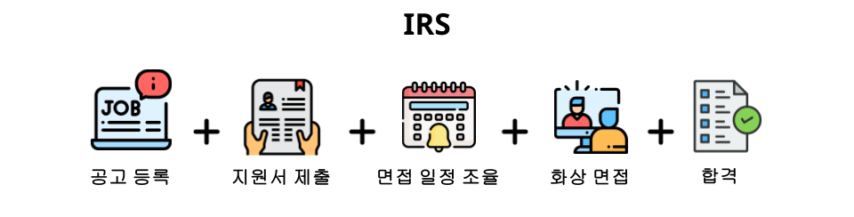

# 통합 채용 시스템  IRS (Integration Recruite System)

    

 

	<h3>
	    🌐 IRS 사이트
	    <a href="https://www.sabujaks-irs.kro.kr/">https://www.sabujaks-irs.kro.kr</a>
	</h3>

 

<b> 👩🏻‍💻 프로젝트 멤버</b>

### SABUJAKS

<table>
  <tr>
    <td>
      
    </td>
    <td>
      
    </td>
    <td>
      
    </td>
    <td>
      
    </td>
  </tr>
  <tr>
    <td align="center">
      <a href="https://github.com/eunjooNine">구은주</a>
    </td>
    <td align="center">
      <a href="https://github.com/mpqm">박종성</a>
    </td>
    <td align="center">
      <a href="https://github.com/SihyunSeo">서시현</a>
    </td>
    <td align="center">
      <a href="https://github.com/seo-jae-eun">서재은</a>
    </td>
  </tr>
</table>

 

<b> 🏃 프로젝트 소개</b>

### 프로젝트 배경
- 기업별로 각기 다른 채용 절차와 복잡한 지원 방식으로 인해 구직자들은 적합한 공고를 찾고 지원하는 데에 많은 시간과 노력을 투자해야 한다.
- 각 기업의 채용담당자들도 여러 채용 구인구직 사이트에 구인을 등록한 후의 과정은, 각 회사에서 관리를 해야하는 번거로움이 있다.
### 프로젝트 목표
- 구직자는 지원부터 채용 일정 조율, 화상 면접까지 하나의 서비스를 통해 진행할 수 있다.
- 채용담당자는 공고 등록부터 서류/면접 결과 발표까지 하나의 서비스를 통해 관리할 수 있다.
### 주요 기능
1. 공고
	- 공고 이미지를 직접 업로드하거나 제공된 공고 템플릿을 활용하여 빠르고 쉽게 공고를 생성할 수 있습니다.
 	- **모듈형 구조로 제공되는 10여 가지 지원서 항목**에서 필요한 항목만 선택하고, **자기소개서 문항과 글자 수를 설정**하여 해당 공고에 맞는 지원서를 구성할 수 있습니다.
3. 지원서
   	- 각 공고에 지원하기 위해 **모듈형 지원서 작성 기능**을 제공합니다. 미리 작성된 통합 지원서를 불러와 간편하게 새로운 지원서를 작성할 수 있습니다.

5. 면접 일정 조율
   - (신입) 채용 담당자가 확정한 면접 일정을 이메일 또는 사이트 내 알림 관리를 통해 안내받습니다.
   - (경력) 채용 담당자가 제안한 면접 일정을 이메일 또는 사이트 내 알림 관리를 통해 안내받고, 해당 **일정을 다시 조율**할 수 있습니다.
7. 화상 면접
   - 공고 작성 시 선택한 채용 절차에 따라 1차, 2차 화상 면접을 진행할 수 있습니다.
   - 면접일 하루 전 **자동으로 Openvidu를 통해 면접방이 생성**되고, 면접 참여자들에게 **이메일을 통해 면접방 입장 안내**를 합니다.
   - 면접에 참여하는 면접관은 면접 평가표를 작성하여 채용 담당자에게 전달할 수 있습니다.
9. 결과 알림
	- 공고 작성 시 선택한 **결과 발표일 오후 4시에 Spring Batch를 통해 자동**으로 전송되는 결과 안내 이메일 또는 사이트 내 알림 관리를 통해 결과를 확인 할 수 있습니다.

 

<b> 🎮 프로젝트 스택 </b>

 

| **CATEGORY** | **SKILLS**                                                                                                                                                                                                                                                                                                                                                                                                                                                                                                                                                                                                                                                                                                                                                                                                                                                                                                                                                                                                                                                                                                                                                                                                                                                                                                     | 
|--------------|----------------------------------------------------------------------------------------------------------------------------------------------------------------------------------------------------------------------------------------------------------------------------------------------------------------------------------------------------------------------------------------------------------------------------------------------------------------------------------------------------------------------------------------------------------------------------------------------------------------------------------------------------------------------------------------------------------------------------------------------------------------------------------------------------------------------------------------------------------------------------------------------------------------------------------------------------------------------------------------------------------------------------------------------------------------------------------------------------------------------------------------------------------------------------------------------------------------------------------------------------------------------------------------------------------------|
| **FRONTEND** |                                                                                                                                                                                                                                                                                                                                                                                                                                                                                                                                                                                                                                 |
| **BACKEND**  |                                                                                                                                                                                                                                                                                                                                                                                                                                                                            |
| **DATABASE** |                                                                                                                                                                                                                                                                                                                                                                                                                                                                                                                                                                                                                                                                                                                                                                                                                                                                                                                                                                                                                                                                                                                        |
| **INFRA**    |              |                                                                                                                                                                                                                                                                                                                                                     
|

 

<b> 🗄️ 프로젝트 문서 </b>

 

| **프로젝트 개발 산출물**       | **링크**                                                                                                                                              |
|-----------------------|-----------------------------------------------------------------------------------------------------------------------------------------------------|
| 🎡 ERD & Architecture | [ERD & Architecture](meta/docs/irs-ERD%20%26%20Architecture.md)                                                                                     |
| ➰ 요구사항 정의서            | [요구사항 정의서](https://docs.google.com/spreadsheets/d/1GIylkjBnw8ZtTUfBgAWqPyGFD1nThtxy/edit?usp=sharing&ouid=117935972514311680024&rtpof=true&sd=true) |
| 📃 WBS                | [WBS](https://docs.google.com/spreadsheets/d/1H2zjZc7OOBaPXe-shFf3dAPJRBftXKH4/edit?usp=sharing&ouid=117935972514311680024&rtpof=true&sd=true)                                                                                                                                             |
| 📃 백엔드 API 명세서        | [백엔드 API 명세서](https://app.notion.com/p/SPRING-SERVICE-IRS-API-f44a64eb8b5083a3933681ad6e927d8b?source=copy_link)                                    |
| 🌱 프론트엔드 화면 설계서       | [프론트엔드 화면 설계서](https://www.figma.com/design/7hhJk8GBwXHjP18kA4C3jb/sabujaks-project?node-id=0-1&t=oWg7N0y2zdBDCPyF-1)                               |
| 🎥 프로젝트 시연 영상         | [프로젝트 시연 영상](meta/docs/irs-프로젝트%20시연%20영상.md)                                                                                                       |
| 📃 벡엔드 개발 문서          | [백엔드 개발 문서](meta/docs/irs-벡엔드%20개발%20문서.md)                                                                                                         |
| 📃 프론트엔드 개발 문서        | [프론트엔드 개발 문서](meta/docs/irs-프론트엔드%20개발%20문서.md)                                                                                                     |
| 📃 CI/CD 개발 문서        | [CI/CD 개발 문서](meta/docs/irs-CICD%20개발%20문서.md)                                                                                                      |

 

