# 🛠 기술 스택
 

  

   

# 🚗 주요 기능
 

## 인증 및 인가
### Refresh Token + Redis

> 사이트 이용 시 유저 편의성과 보안을 동시에 확보하기 위해 Refresh Token과 Redis를 도입했습니다. 이를 통해 사용자 불편을 줄이면서도 탈취된 Token에 대한 대응을 강화하고자 하였습니다.
 

	
<b>도입 전</b>

	 
	➡ Access Token 시나리오
	<ul>
		<li>Access Token만을 사용하여 인증을 진행한다.</li>
		<li>Access Token이 만료되면 사용자는 다시 로그인해야 한다.</li>
		<li>유효기간이 짧아야 보안에 유리하지만, 너무 짧을 경우 서비스 이용 중 빈번한 로그인이 발생하는 문제점이 있다.</li>
		<li>Access Token이 탈취될 경우, 만료되기 전까지는 악의적인 사용자가 이를 사용할 수 있는 위험이 있다.</li>
	</ul>
	 
	👎 문제점
	<ul>
		<li>사용자 불편 증가</li>
		<li>보안 취약성(탈취 시 문제)</li>
		<li>짧은 유효기간으로 인한 잦은 로그인</li>
	</ul>

 

	
<b>도입 후</b>

	 
	➡ Token 저장방식
	<ul>
		<li>Refresh Token은 Redis에 저장되어 관리되며, Refresh Token Rotation(RTR)을 통해 Access Token 만료 시 Access Token과 Refresh Token 모두 재발급한다.</li>
		<li>Redis에 유저 email을 Key로 설정하여 하나의 사용자에 대해 하나의 Refresh Token만 존재하도록 한다.</li>
		<li>Refresh Token의 저장 구조: "key: value = userEmail: refresh token"</li>
		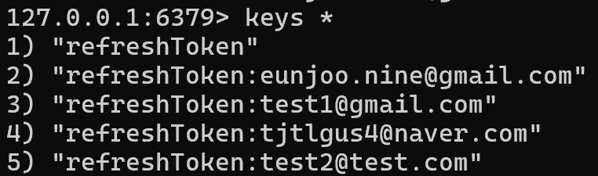 
		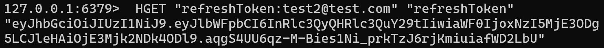
	</ul>
	 
	➡ Refresh Token 시나리오
	<ul>
		<li>정상 유저의 경우, Refresh Token을 사용하여 Redis에서 사용자 정보를 조회하고, 해당 정보와 클라이언트의 쿠키의 Token을 비교해서 정당한 사용자인지를 확인한다. 정상 로그인 후에는 토큰이 갱신되어 서비스를 이어서 사용할 수 있다.</li>
		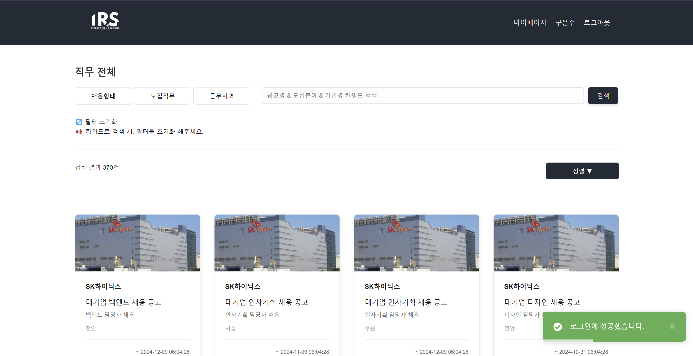 
		<li>만약 탈취범이 먼저 Access Token을 탈취하여 aToken과 rToken을 재발급 받아 redis의 rToken도 변경됐다면, 정상 사용자가 api요청 시에 쿠키의 rToken과 Redis에 저장된 rToken이 불일치하여 탈취로 간주하고 로그아웃 처리하게 된다.</li>
		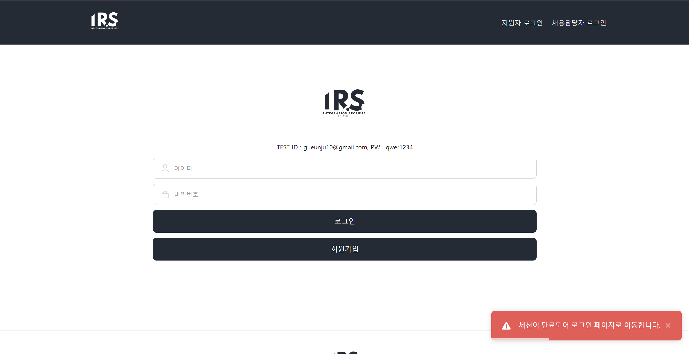 
		<li>이메일을 키로 사용했기 때문에 탈취한 Refresh Token으로 정상 유저보다 먼저 Access Token을 재발급 받는 경우와 (토큰 탈취된 경우) 한 명의 사용자에 여러 refresh token 값이 저장되는 경우도 해결할 수 있다.</li>
	</ul>
	 
	👍 개선점
	<ul>
		<li>사용자 경험 개선(로그인 빈도 감소)</li>
		<li>보안 강화(Refresh Token Rotation)</li>
		<li>Redis를 통한 Token 관리</li>
		<li>악의적인 재발급 방지 및 침투를 인지하여 탈취 시 대응 가능</li>
	</ul>

 

## 접근제어
### Spring Security + Time Check Method

> 지원자는 공고에 지원하고 채용담당자는 서류합격자를 기준으로 면접 일정을 잡습니다. 이때, 공고 UUID와 면접일정 UUID가 생성됩니다.
> 화상 면접 대기방은 /video-interview/{공고UUID}로 화상 면접 방은 /video-interview/{공고UUID}/{면접일정UUID}로 아무나 접근 가능했습니다. 
> 공고에 지원하지 않은 사용자가 공고 UUID와 화상 면접방 UUID를 탈취해 URL을 통해 면접에 접근 가능한 문제를 해결하기 위해 도입했습니다.
 

	
<b>도입 전</b>

	 
	➡ 화상 면접 접근 시나리오
	<ul>
		<li>화상 면접 대기방에 접근: 공고 UUID만 있으면 공고에 지원하지 않은 지원자도 ~/video-interview/{공고UUID}를 입력해 접근 가능</li>
		<li>화상 면접 방에 접근: 공고 UUID 및 면접 일정 UUID만 있으면 면접 일정이 잡히지 않은 지원자도 면접방에 ~/video-interview/{공고UUID}/{면접일정UUID}를 입력해 접근 가능<</li>
	</ul>
	 
	👎 문제점
	<ul>
		<li>공고에 지원하지않은 지원자나 면접 일정에 속하지 않는 제3자의 접근 가능성</li>
		<li>위의 이유로 인한 면접관인척 지원자들의 지원서를 열람 및 평가 가능성 및 대리 면접 가능성</li>
	</ul>

 

	
<b>도입 후</b>

	 
	➡ 화상 면접 대기방에 접근
	<ul>
		<li>스프링 시큐리티의 접근제어를 통해 InterviewPaticipate 테이블을 조회해 권한을 확인하는 함수</li>
		<li>공고 UUID 및 면접 일정 UUID가 지원자에게 있다면 접근을 허용</li>
		<li>공고 UUID 및 면접 일정 UUID가 지원자에게 없다면 접근을 거부</li>
		 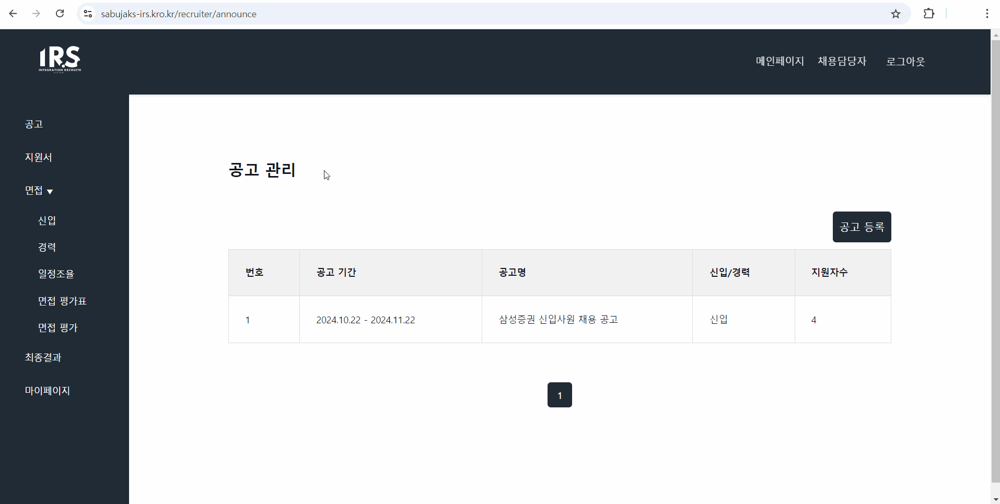
	</ul>
 	➡ 화상 면접 방에 접근
	<ul>
		<li>화상 면접 방에 참가할 수 있는 Session-Token 발행시 시간대 확인 함수를 통해 면접참여 및 면접스케줄 테이블을 조회해 면접 접속 시간을 확인</li>
		<li>서버시간과 확인한 값을 비교해 3분전에 접속 가능하게 만든 함수</li>
		 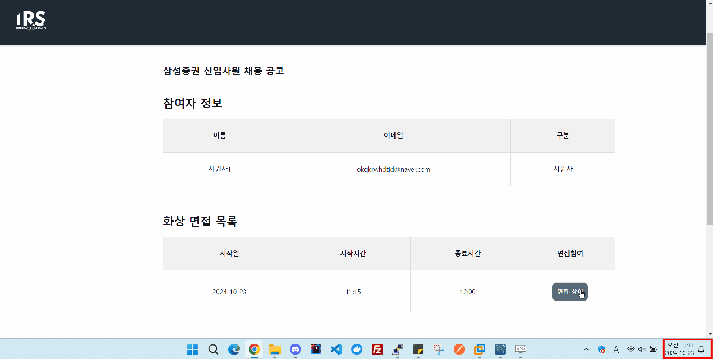
	</ul>
	 
	👍 개선점
	<ul>
		<li>코드 단에서 접근제어 함수의 DB 조회가 많이 발생</li>
		<li>시간대 접근제어 부분은 서비스 단에서 시행됨, 스프링 시큐리티가 이를 위임해야함</li>
	</ul>

 

## 검색 성능 개선
### QueryDSL + 페이징 처리
> 메인 페이지에서 공고 조회 시간을 줄이고, 채용 형태, 모집 직무, 근무 지역, 키워드를 활용하여 효율적인 검색을 구현하기 위해 적용하였습니다.
 

	
<b>QueryDSL + 페이징 처리</b>

	 
	➡ QueryDSL
	<ul>
		<li>QueryDSLJPQL을 Java 코드로 작성할 수 있도록 하는 라이브러리</li>
		<li>자바 코드로 쿼리를 작성함으로 컴파일 시점에 에러를 잡을 수 있다.</li>
		<li>복잡한 동적 쿼리를 쉽게 다룰 수 있다.</li>
	</ul>
	➡ 페이징 처리
	<ul>
		<li>데이터를 일정한 크기로 나누어 출력하는 방법</li>
		<li>대량의 데이터를 효율적으로 처리</li>
		<li>사용자 경험 개선</li>
	</ul>

 

	
<b>QueryDSL + 페이징 처리 전, 후 비교</b>

	 
	🎒 QueryDSL + 페이징 적용 전 → 37.26 s
	 
	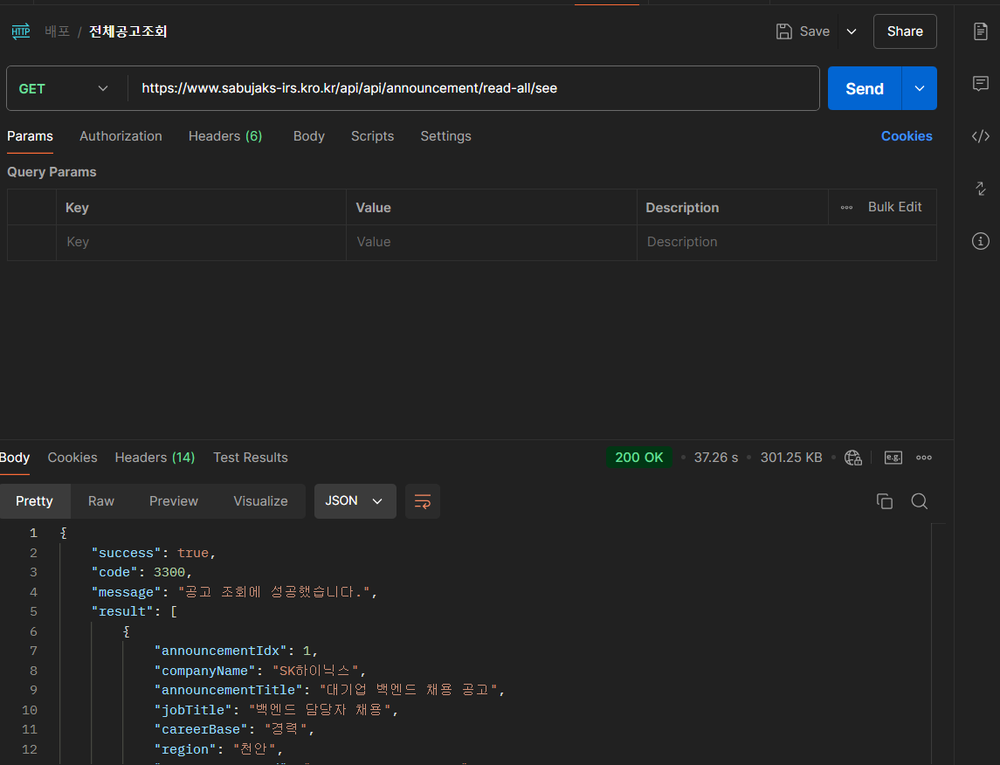
	  
	🔅 QueryDSL + 페이징 적용 후 → 1.534 s 
	 
	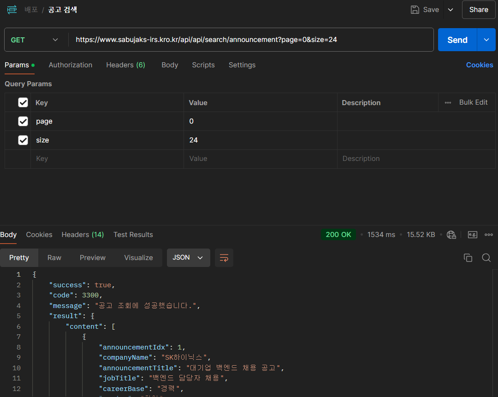

 

## 알림
### Spring Batch 도입
> 기존 @Scheduled 어노테이션을 사용한 스케줄링 방식으로 서버의 부하가 발생하여 Spring Batch를 통해 알람 기능을 구현하였습니다.

    
<b>패키지 구조 변경</b>

     
    <ul>
        <li>배치 서버를 적용하면서 리소스 경쟁 최소화, 스케일링 용이성, 유지보수 및 확장성 향상을 고려하여 모듈화를 진행하였다.</li>
    </ul>
    

        <table>
	  <tr>
	      <td>➡ 기존 패키지 구조</td>
	      <td>➡ 모듈화 패키지 구조</td>
	  </tr>
	  <tr>
	      <td>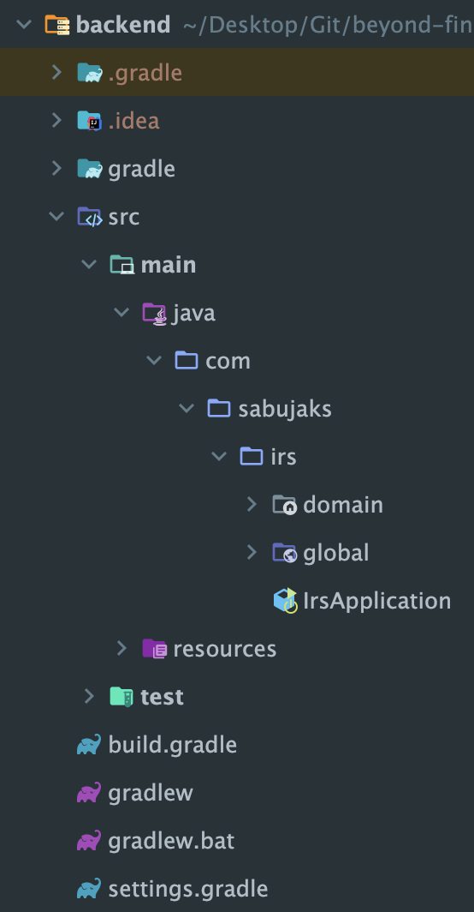</td>
	      <td>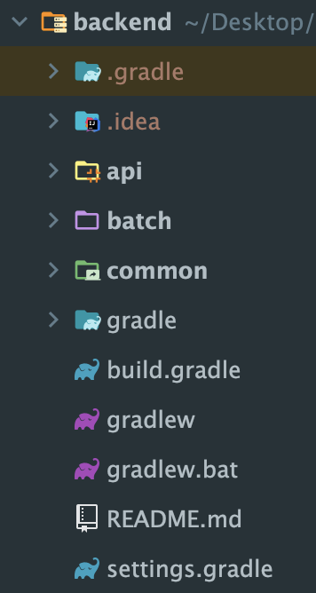</td>
	  </tr>
        </table>	
    

 

    
<b>Spring Batch</b>

    <ul>
        <li>기존의 서비스 코드로는 서버의 부하로 인해 안정적인 서비스 제공이 어렵다고 판단하였다.</li>
    </ul>
    

        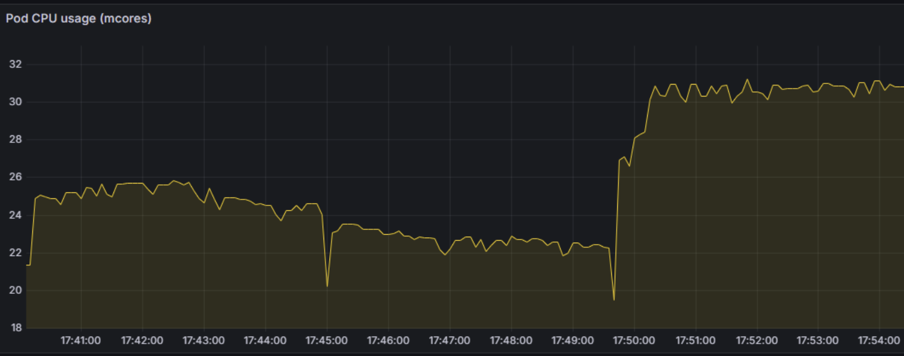
    

    <ul>
        
1. 역할 분리

        
- 각 Step마다 Reader, Processor, Writer의 구성을 통해 기능을 나눴다.

        
- Chunk-Oriented Processing(청크 기반 처리)을 사용해 각 Step이 서로 다른 비즈니스 로직을 수행하도록 구성하였다.

         
        
2. 부하 분산

        
- 백엔드 서버 내에서 모든 알람(도메인내 알람, 이메일 알람)을 처리하던 방식에서, 독립적인 배치 서버를 구축하여 알람을 처리하게 하여, 부하를 분산시켰다.

        
- 부하 분산을 통해 기존 메인 서버의 부하를 줄이고, 알람 일괄 전송 과정중 오류가 발생하더라도 메인 서버에 영향을 최소화하여 안정적인 서비스를 제공할 수 있다.

        
- Kubernetes에서 배치 서버를 주기적으로 실행시키기 위해 CronJob을 설정하여 주기적인 작업을 자동화 하였다.

    </ul>
     
    <ul>
        
➡ 배치 적용 후

        

            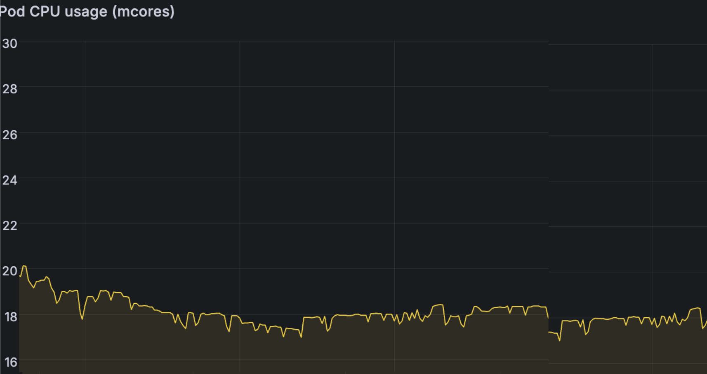
        

    </ul>

 

## 화상 면접
### OpenVidu
> 화상 면접 기능을 구현하기 위해 SFU 방식인 WebRTC 라이브러리인 OpenVidu를 도입했습니다.
 

	
<b>WebRtc + OpenVidu</b>

	 
	➡ OpenVidu 구성 요소
	<ul>
		<li>OpenVidu Server: WebRTC를 제어하고 세션을 관리하는 서버</li>
		<li>Kurento Media Server(KMS): 미디어 스트림을 처리하고 필요한 경우 변환(transcoding)을 수행</li>
		<li>OpenVidu Browser Client: 사용자의 브라우저에서 OpenVidu API를 이용하여 비디오 및 오디오를 송수신</li>
	</ul>
	➡ OpenVidu 통신 방식
	<ul>
		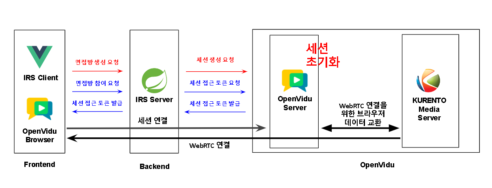
	</ul>
	➡ OpenVidu 화면
	<ul>
		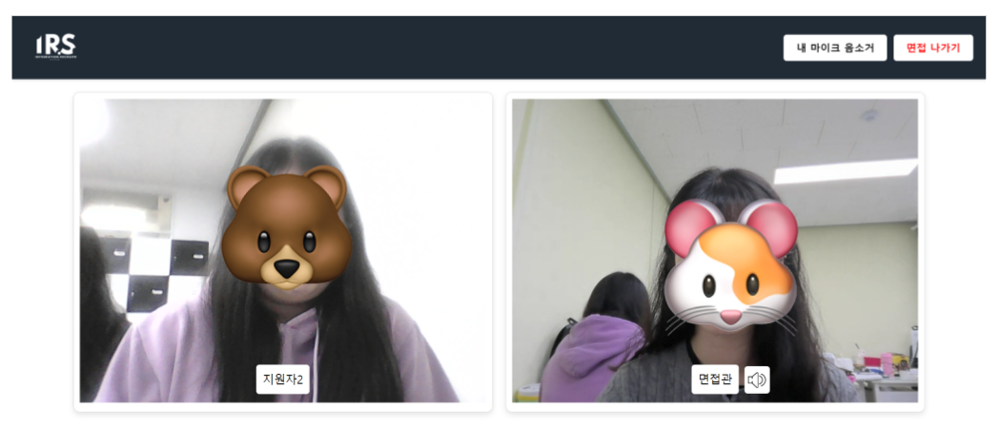
	</ul>

