# 🛠 기술 스택
 

</a>
</a>
</a>
</a>
</a>
</a>
</a>

   

# 🌳 Vue.js를 선택한 이유
 

## 1️⃣ Vue API 스타일 → "Composition API"
### Optional API VS Composition API
#### 구조와 가독성
Options API는 data, methods 등으로 로직을 나누지만, 복잡해지면 가독성이 떨어집습니다. 반면, Composition API는 **관련 로직을 함수 단위로 묶어 코드의 흐름이 명확**합니다.

#### 재사용성과 모듈화
Options API의 믹스인(Mixin)은 충돌 위험이 있지만, Composition API는 composable 함수를 통해 **독립적이고 재사용 가능한 로직 구성이 가능**해 테스트와 관리가 용이합니다.

#### 유연한 상태 관리
Composition API는 **상태와 라이프사이클을 직접 관리**해 다양한 상태를 쉽게 조합하고 확장할 수 있습니다.

#### Vue 3 생태계와의 호환성
Vue 3의 최신 기능 및 라이브러리와 호환되므로, **확장성과 유지보수 면에서 유리**합니다.
  

## 2️⃣ SPA (Single Page Application) 구현
Vue를 통해 SPA로 개발하여 페이지 이동 시 화면 전환 없이 동적으로 콘텐츠가 업데이트되도록 했습니다. 이를 통해 사용자 경험을 향상하고, 부드러운 네비게이션을 제공할 수 있도록 고민했습니다.
  

## 3️⃣ 상태 관리
Pinia를 활용해 전역 상태를 효율적으로 관리하였으며, 각 컴포넌트가 필요한 데이터에 쉽게 접근하고 반응형으로 업데이트될 수 있도록 했습니다. 이를 통해 코드의 가독성과 유지 보수성을 높이는 동시에, 사용자 인터랙션에 따라 동적으로 상태가 변하도록 구현했습니다.
  

## 4️⃣ 컴포넌트 기반의 모듈화
Vue의 컴포넌트 시스템을 사용해 UI 요소를 모듈화하고 재사용 가능한 컴포넌트로 분리했습니다. 이로 인해 코드의 재사용성을 높이고, 수정 시 특정 컴포넌트만 업데이트할 수 있어 유지보수 효율을 향상시켰습니다.

   

# 📜 상세 기능 설명서
 

### 🚪 공통 🚪 

    

 회원가입 & 기업인증 

1. 채용담당자는 기업인증 후, 인증에 입력했던 이메일로 회원가입을 해야 합니다. 이메일 인증 완료 후 계정 이용이 가능합니다.

	
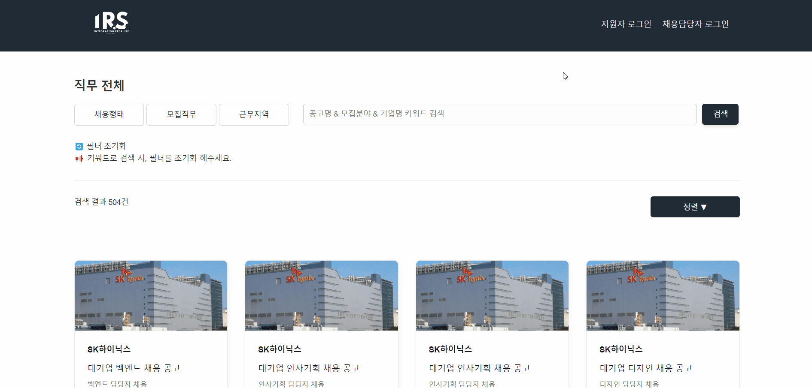

2. 지원자는 이메일 인증 완료 후 계정 이용이 가능합니다.

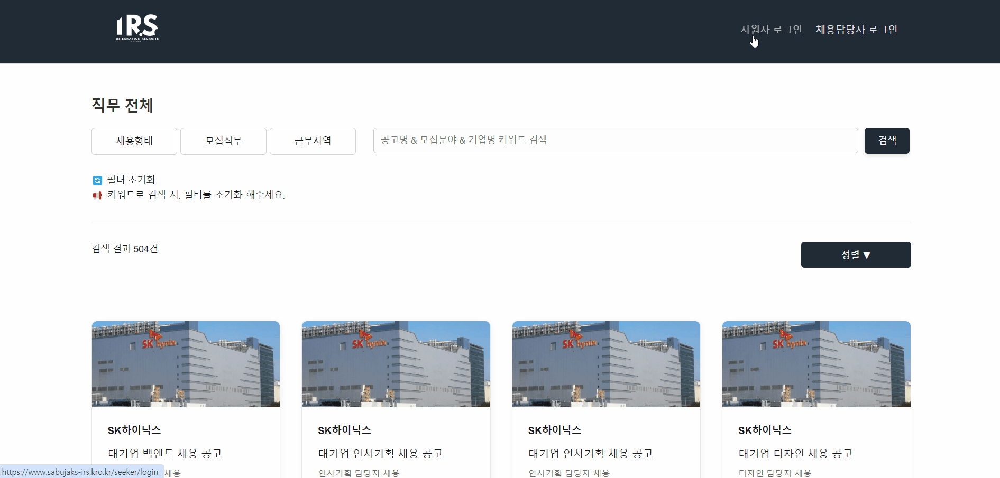

    

 로그인 

1. 채용담당자는 이메일과 비밀번호로 로그인합니다.

2. 지원자는 이메일과 비밀번호로 로그인합니다.

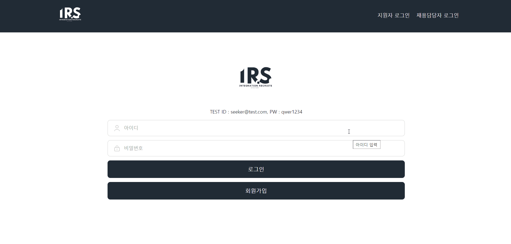

 

### 🏢 채용담당자 🏢

    

 기업 등록 

1. 공고 등록 전에 마이페이지에서 기업을 먼저 등록합니다.

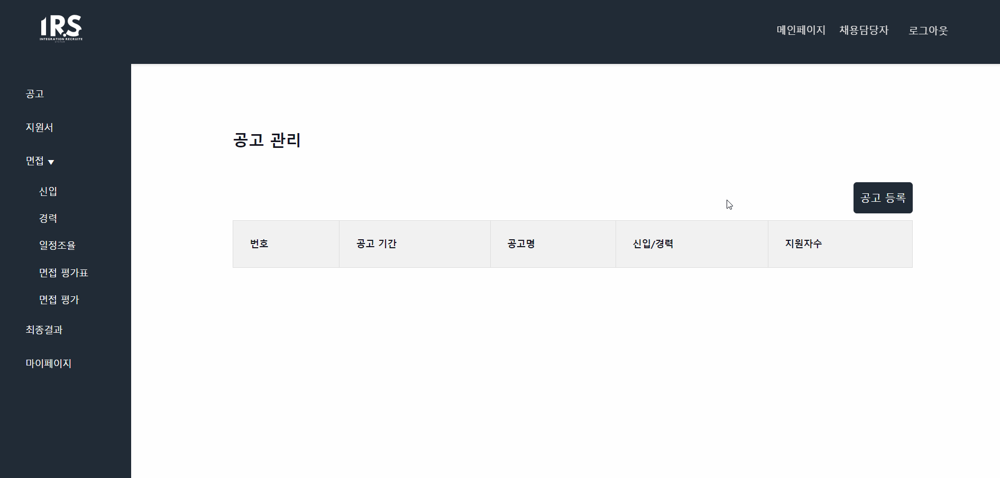

    

 공고와 지원서 폼 등록 

1. 이미지 또는 템플릿으로 공고를 등록합니다.

2. 등록한 공고에서 받을 지원서 폼을 조립합니다. 자기소개서 폼은 문항까지 입력한 후 등록합니다.

	

    

 지원자 서류합격 

1. 각 공고에 지원한 지원자의 지원서를 관리 할 수 있습니다.

2. 서류를 합격, 불합격 처리합니다.

3. 서류전형 결과는 이메일과 사이트 알람으로 각 지원자에게 알림을 보냅니다.

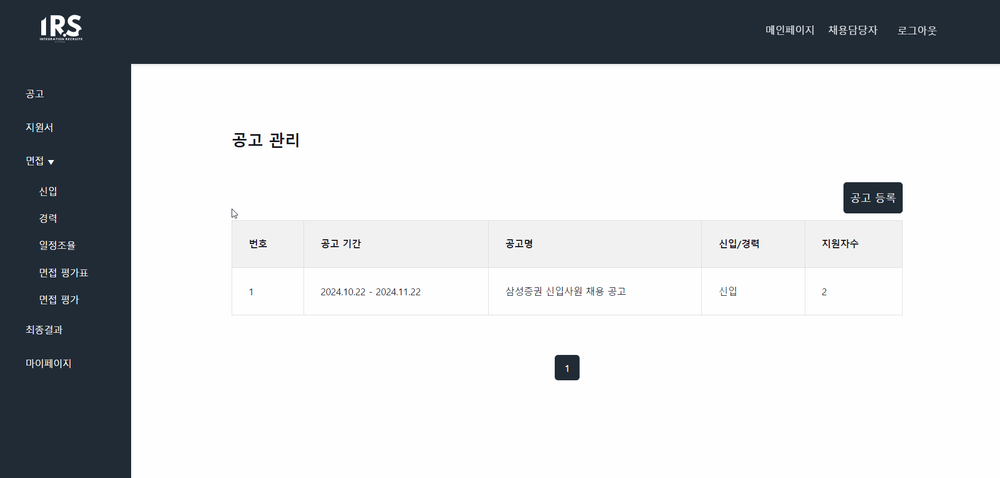

    

 면접 일정 관리 

1. 각 공고의 서류합격 지원자들을 대상으로, 면접관 정보와 날짜를 설정한 후 면접일정을 생성합니다.

 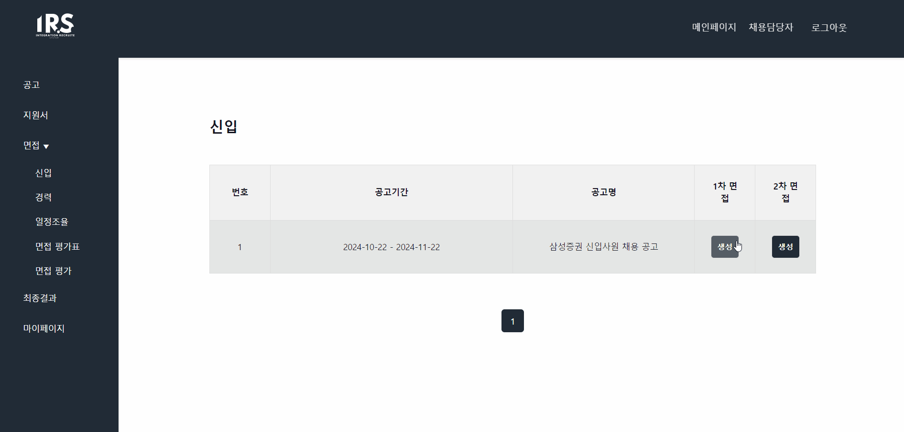

2. 신입은 일괄처리로 날짜를 지정하여 생성하고, 경력은 채용담당자와 지원자 간 일정을 조율 할 수 있습니다.

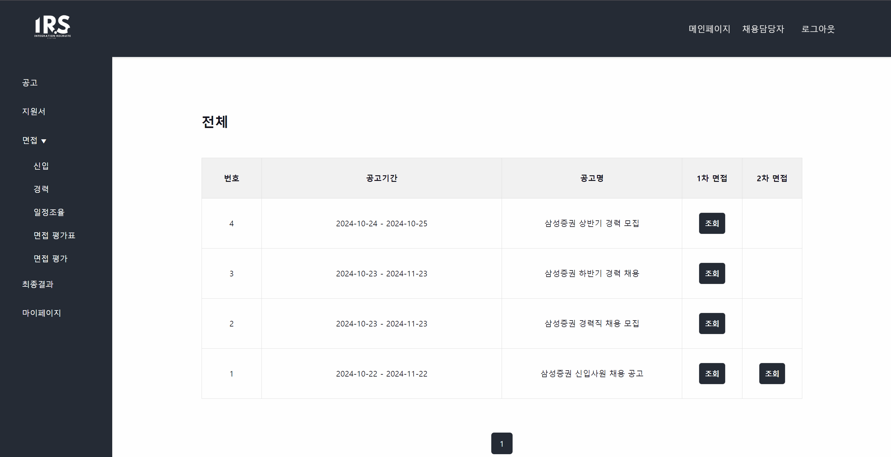

3. 면접관 메일로 면접용 임시 비밀번호와 입장 주소를 전송합니다.

    

 화상 면접방 생성 

1. 정해진 면접 일정에 따라 화상 면접방을 생성합니다.

	
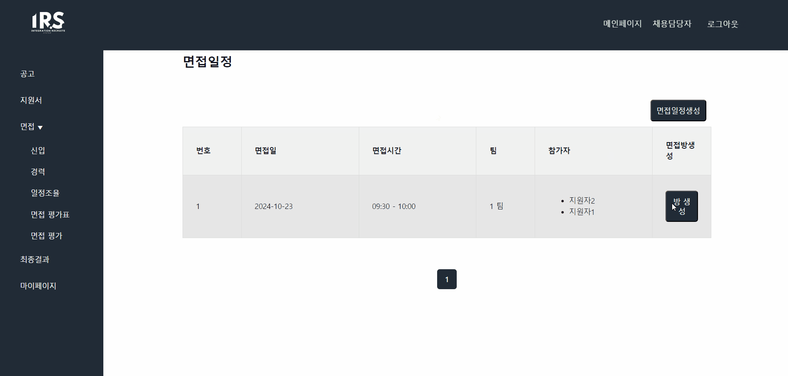

2. 면접방은 지정한 면접일 하루 전날에 일괄 생성됩니다.

    

 면접 평가 관리

1. 화상 면접 시에 면접관이 평가할 면접 평가서를 생성합니다.

 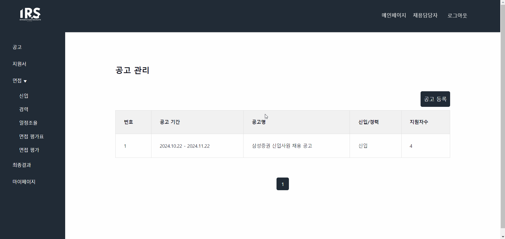

2. 채용담당자는 각 면접방마다 진행되고 있는 채용 프로세스 결과를 확인 할 수 있습니다.

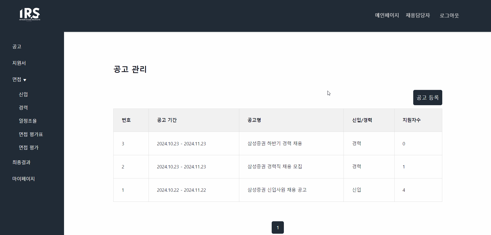

3. 모든 채용 프로세스가 끝나면 최종 결과를 이메일과 사이트 알람으로 전송합니다.

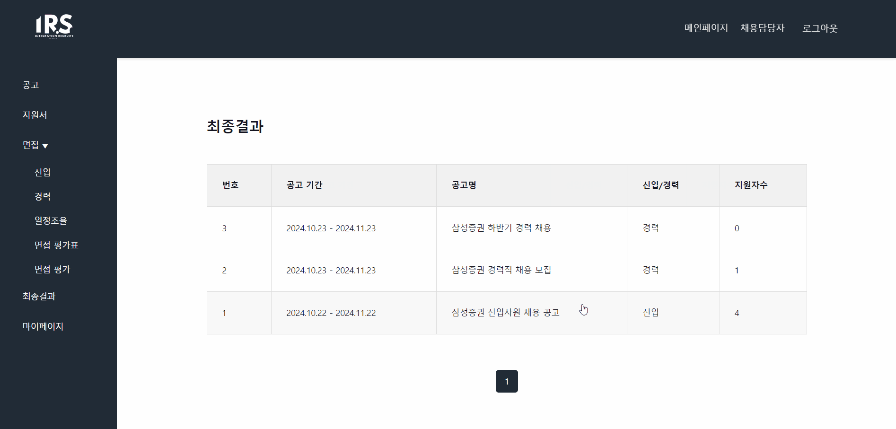

 

### 🖥️ 면접관 🖥️

    

 면접 참여 & 평가

1. 이메일에 있는 IRS 사이트 주소로 입장 후 로그인을 하여 면접방에 참여 할 수 있습니다.

	
.gif)

2. 화상 면접을 하면서 각 지원자를 평가합니다.

 

### 🧑‍💼 지원자 🧑‍💼

    

 공고 검색 

1. 기업, 모집직무, 지역, 키워드로 공고를 검색할 수 있습니다.

	
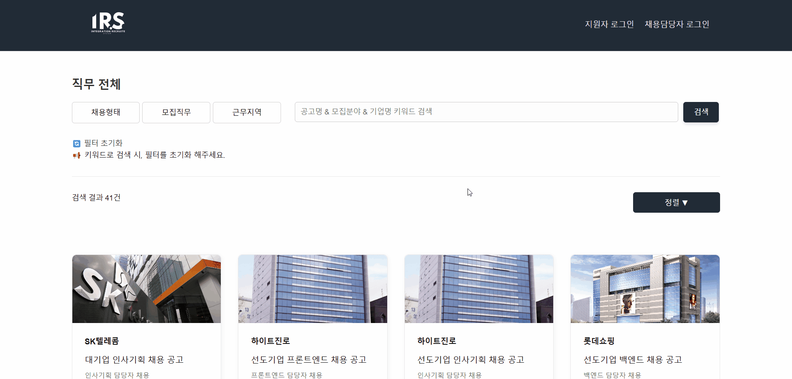

2. 마감임박순, 

    

 통합 지원서 작성 

1. 마이페이지의 메뉴 중 통합지원서 관리를 눌러 작성된 지원서가 없으면 작성 할 수 있습니다.

2. 작성한 통합지원서가 있으면 조회됩니다.

	

    

 공고 지원 

1. 공고를 보고 마감 전에 지원할 수 있습니다.

2. 통합지원서를 작성했다면, 지원하기를 클릭했을 때 작성된 폼들을 조회하여 입력 해 집니다.

	
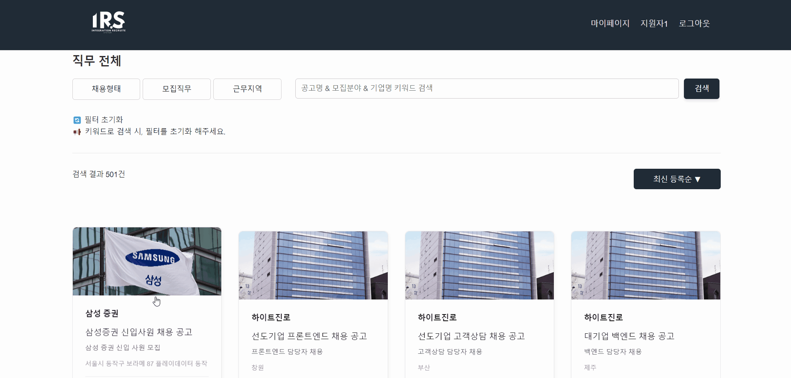

    

 공고 별 지원한 지원서 관리 

1. 마이페이지에서 공고 별 지원한 지원서와 각 프로세스 결과를 확인할 수 있습니다.

    

 채용 과정 알림 

1. 이메일과 사이트의 마이페이지에서 서류결과 알림을 확인 할 수 있습니다.

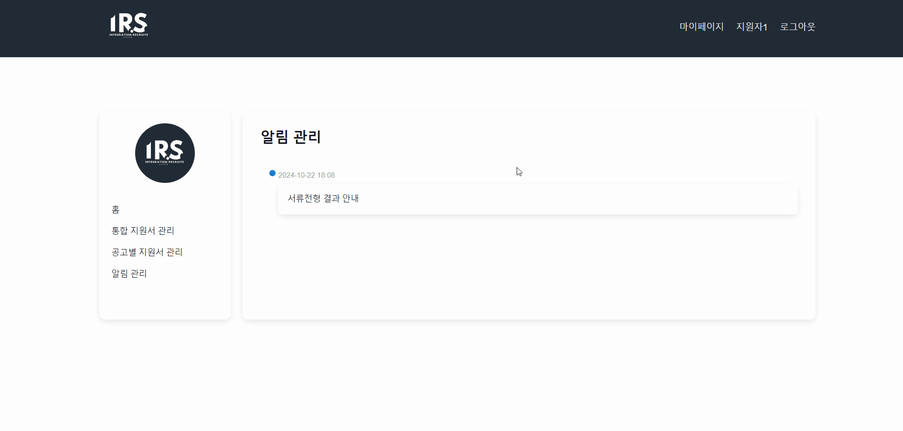

    

 면접 일정 조율 

1. 경력 지원일 때, 채용담당자가 면접일정 알람을 보내면, 가능한 날짜를 선택하여 조율을 요청할 수 있습니다.

	

    

 화상 면접 참가

1. 면접 날짜와 시간에 맞춰 면접방에 입장할 수 있습니다.

	

   
